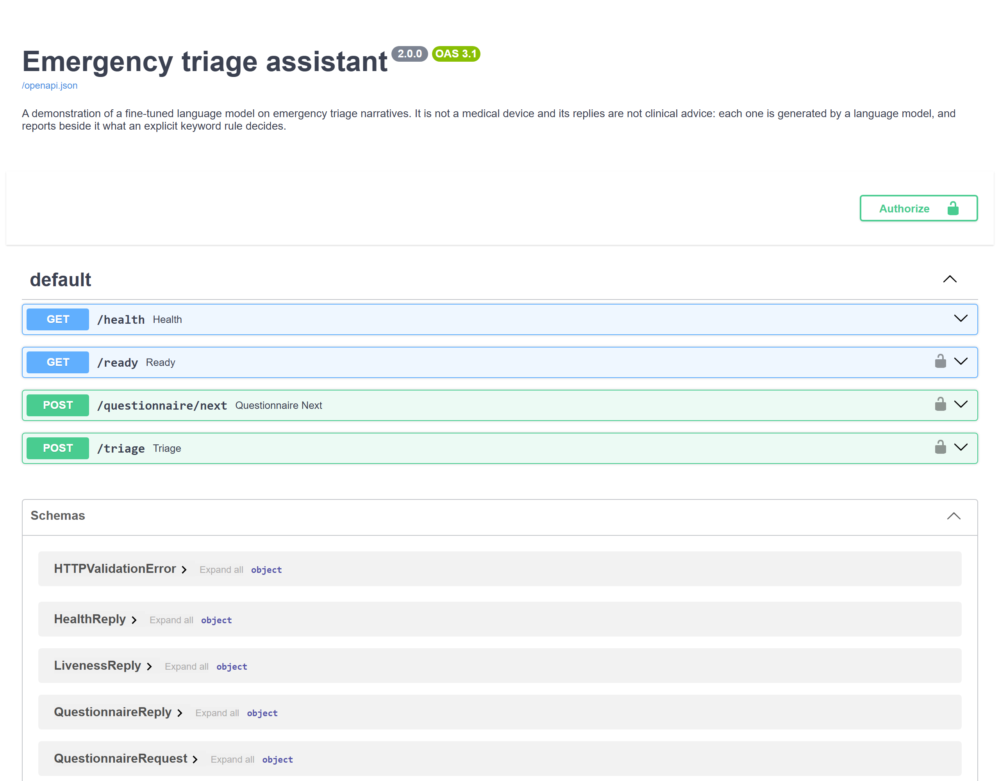
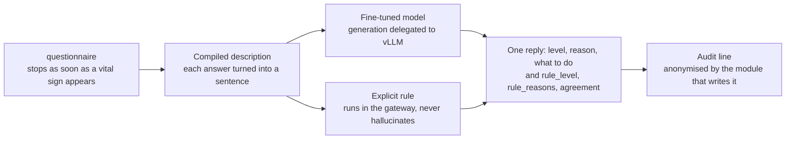
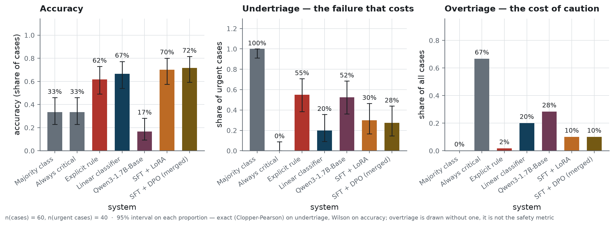
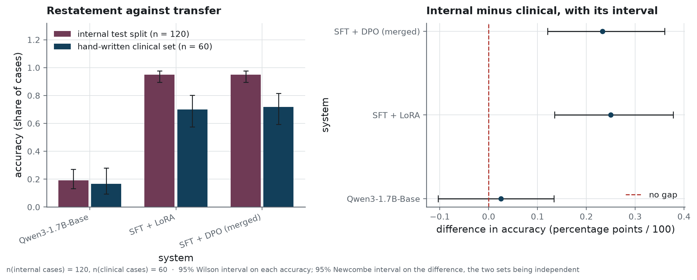
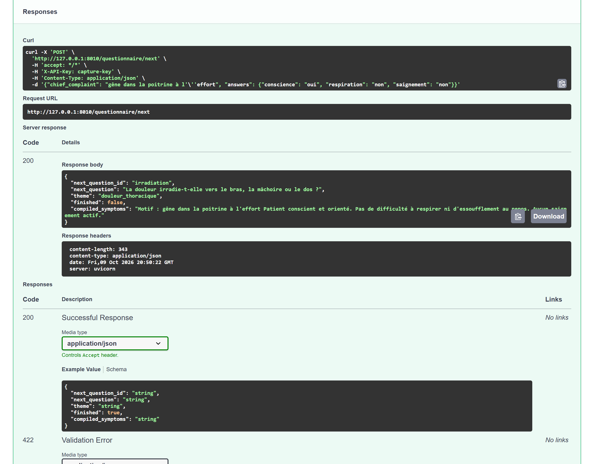

<h1 align="center">Emergency triage assistant</h1>

<p align="center">A small language model fine-tuned for emergency triage, that says when the explicit rule disagrees</p>

<p align="center">
  
  
  
  
</p>

**Project status** — version 2.0.0, finished. The language model was fine-tuned for emergency
triage, preference-aligned with DPO and evaluated on one RTX 4060 Ti in October 2026, on three
training seeds. The results are committed, and every number below names the file it comes from.

- **Model and dataset**: on the Hugging Face Hub, as
  [`qwen3-1.7b-clinical-triage`](https://huggingface.co/BenoitJT-GIRARD/qwen3-1.7b-clinical-triage)
  and [`clinical-triage-bilingual`](https://huggingface.co/datasets/BenoitJT-GIRARD/clinical-triage-bilingual),
  with cards rendered from this repository at the same tag.
- **Service**: deployed on Modal and left stopped, at no cost. Only the owner of this repository
  can start it, for a demonstration
  ([how it is started](infra/README.md#4-cloud-deployment-on-modal)).
- **Evidence**: `reports/run-evidence.json`, written by `scripts/smoke.py`, which redraws every
  published figure from the committed results and writes nothing if one of them comes out
  different.
- **Workflows**: started by hand; nothing sets them off on its own.

**This is not a medical device, and nothing it returns is clinical advice.** It is a
demonstration built to study how a small language model can be fine-tuned and aligned for a
structured task. No patient should be routed on what it outputs.

## The problem

A triage nurse decides, from a narrative and a couple of minutes, whether a patient is seen now,
within a few hours, or later. One of the two ways of being wrong costs a waiting-room place. The
other costs a patient, and it is the one this repository measures: **undertriage**, a patient
sent down the queue who should have gone up it.

A department can write a keyword rule in an afternoon, and that rule is the thing to beat. On the
sixty hand-written cases of this evaluation it misses more than half the urgent ones, because it
reads words: a chest pain described without the word "pain" is invisible to it. The question is
whether a large language model small enough to serve on one card, fine-tuned on the department's
own vocabulary and then preference-aligned, does better than that rule, and whether it still does
better in the harder comparison, against an ordinary classifier trained on the same examples.

Most of the work went into the ground truth. No public medical corpus is labelled in triage
levels, so it had to be built: a clinical catalogue written for the
project, a generator that draws vignettes from it, and four public corpora read in full, three of
which yielded cases that describe a patient. How, and what each source really yielded, is in
[`data/README.md`](data/README.md) and [`docs/data-source.md`](docs/data-source.md).

## What it does

The service has four routes, and the project is built around the second one.

| Route | What it answers |
|---|---|
| `POST /questionnaire/next` | the next question to ask, chosen from the complaint; collection stops as soon as a vital sign appears |
| `POST /triage` | the triage level, why, what to do, **and what the explicit rule would have decided** |
| `GET /health` | whether the gateway is alive; it touches nothing else, and needs no key |
| `GET /ready` | whether the inference engine answers; it asks for the key, since on a managed host it can wake a GPU |

<!-- source: docs/images/MANIFEST.json -->


If that disagreement were hidden, the nurse would read a level without knowing that the rule,
which never hallucinates, would have sent the patient elsewhere. That is why `rule_level`,
`rule_reasons` and `agreement` travel in every reply, beside the model's own answer.



### How it is built

`Qwen3-1.7B-Base` is fine-tuned with LoRA on the project's bilingual set. **Transformers**
holds the model, **PEFT** holds the adapter, **TRL** runs the supervised pass and then the DPO
pass over preference pairs that each carry one deliberate defect, and **Unsloth** supplies the
kernels that make it faster and lighter on one consumer card. **PyTorch** is underneath all
four. Every run writes to a local **MLflow** store, so the four LoRA settings can be compared
after the fact from what was recorded. The ordinary baseline is a **scikit-learn** linear
classifier over n-grams, trained on the same examples, and it is the demanding comparison.

Serving runs as two processes. A **FastAPI** gateway behind **Uvicorn** validates the request, runs
the questionnaire, applies the explicit rule, anonymises and logs; **vLLM** does the generation
over its OpenAI-compatible route. Request and reply shapes are **Pydantic** models, so the contract
page above is generated from them. The gateway's **Docker** image carries neither weights nor
torch, so a new model version ships without rebuilding it. **Modal** runs that same pair in the
cloud: a GPU engine that shuts down after fifteen idle minutes, and the gateway unchanged. It stays
stopped between demonstrations.

**uv** holds the environment to its lock file, **Ruff** and **Bandit** read every run, and
**pytest** works in three tiers; the last one starts the gateway in a process of its own and talks
to it over the network. `datasets` keeps its cache in Arrow, and the **Parquet** reader is imported
before torch in the suite, because on Windows the other order ends the process with an access
violation.

## The result

The evaluation uses sixty cases written by hand, forty of them urgent. None of them was seen
during training, and none was labelled by the rule the model is compared against. The models in
the table are those of seed 42, the seed fixed in advance as the one shipped.

<!-- source: reports/evaluation_results.json -->
| system | accuracy | undertriage | overtriage | format compliance |
|---|---|---|---|---|
| majority class | 0.333 | 1.000 | 0.000 | n/a |
| always critical | 0.333 | 0.000 | 0.667 | n/a |
| explicit rule | 0.617 | 0.550 | 0.017 | n/a |
| linear classifier | 0.667 | 0.200 | 0.200 | n/a |
| `Qwen3-1.7B-Base` | 0.167 | 0.525 | 0.283 | 0.467 |
| SFT + LoRA | 0.700 | 0.300 | 0.100 | 1.000 |
| SFT + DPO, merged | 0.717 | 0.275 | 0.100 | 1.000 |
> n = 60 cases, of which n = 40 are urgent: undertriage is counted on those forty alone,
> everything else on all sixty. What each column measures, and with which estimator, is in
> [`metrics.yaml`](metrics.yaml).

> **How to read it.** One row per system, all answering the same sixty cases. `accuracy` is the
> share filed at the reference level written for each case. `undertriage` is the share of the urgent
> cases sent somewhere gentler, which is the failure that reaches a patient, so it is counted on the
> forty urgent ones alone. `overtriage` is the share pushed above their level, which costs a place
> in the queue. `format compliance` is the share an information system can parse at all; the four
> baselines output a bare level, which leaves nothing to parse (n/a).

<!-- source: reports/figures/MANIFEST.json -->


> **How to read it.** Three panels, one per measure, with one bar per system. The middle panel
> is the one to read first: shorter is better there, and it counts urgent patients sent somewhere
> gentler. The right-hand panel runs the other way round, since caution costs a queue place and
> nothing worse. The accuracy and undertriage bars carry a 95% interval; overtriage, which is
> not the safety measure, carries none. Overlapping intervals do not make two systems alike: on
> the same cases, the paired tests below decide.

<!-- source: reports/evaluation_results.json -->
Against the rule it would replace, the shipped model halves undertriage on the n = 40 urgent
cases of that set: **11** missed, against **22**. A paired test on the same cases, which is how
two systems that saw the same patients have to be compared, gives **p = 0.035**. This comparison
was fixed as the primary analysis before the model was evaluated. The release gate asks less of
it: a model that misses more urgent cases than the rule is not published.

<!-- source: reports/evaluation_results.json -->
Against the ordinary classifier the result is different, and the project publishes it as a
finding: on the same n = 40 urgent cases the model misses **11** and the classifier **8**, and the
paired test gives **p = 0.508**. Fine-tuning adds a justification and a course of action a nurse
can read, but it shows no sign of a better triage decision than n-grams and a linear SVM.

### Both opinions, read together

<!-- source: reports/evaluation_results.json -->
The reply carries the model's level and the rule's. Keep the more urgent of the two, case by case,
and on the same n = 40 urgent cases the misses fall from **11** to **5**: six urgent patients
caught, none lost, **p = 0.031**. Overtriage does not move, at **0.100**, because the rule almost
never overshoots. That reading was fixed in advance as well, and it needs no new model: it is what
the service already returns. The five it still misses are missed by the model and the rule alike.

### What the model restates, and what it transfers

<!-- source: reports/figures/MANIFEST.json -->


> **How to read it.** The left panel puts two accuracies side by side for each system: one on
> the internal split, whose cases resemble the training material, and one on the hand-written
> clinical set, which nothing in training resembles. The right panel is the gap between them with
> its interval. A large positive gap means a system restating what it memorised; a gap whose
> interval contains zero shows no loss this sample can detect.

<!-- source: reports/evaluation_results.json -->
On a random sample of the internal test split, n = 120 cases, the model scores **0.950**. That
number measures restatement, not triage: most cases in that split were generated from
presentations seen during training under another wording, and the rest are corpus cases labelled
by the same rule as the corpus cases it trained on. The clinical set, n = 60, is the one that
measures transfer, and the model scores **0.717** there. The drop from **0.950** is how far a
single-set evaluation would have overstated its accuracy.

### What the alignment learnt

<!-- source: reports/evaluation_results.json -->
On n = 100 preference pairs built on the hand-written cases, the alignment favours the right answer
over the defective one in **0.84** of them: what it learnt on generated narratives holds on written
ones. On the n = 777 pairs of an external medical preference set it does so in **0.3655**, below
chance, and on the n = 180 of those pairs whose two answers are of similar length, in **0.500**
exactly. It learnt the defects it was shown, not medicine at large; its score below
chance reflects answer length. On the clinical set the aligned model misses one
urgent case fewer than the supervised one.

### Three trainings, one shipped

<!-- source: reports/seed_study.json -->
The method was trained three times, on seeds 42, 43 and 44, and seed 42 was chosen for publication
before any of them was evaluated. Across the three, clinical accuracy (n = 60 cases) spans **0.700**
to **0.783**, and the urgent cases missed, out of n = 40, from **9** to **13**: training alone moves
the result by up to five cases in sixty. Seed 42 sits in the middle of the three, and even the worst
seed misses far fewer urgent patients than the rule. Across the 120 urgent decisions of the three
seeds, the alignment rescues one patient and loses none.

### Against the previous version

<!-- source: reports/before_after.json -->
The model this repository served before, version 1.0.0, run through the same evaluation on the same
n = 60 cases, also scores **0.717**. Of the n = 40 urgent cases, it misses **10** where this version
misses **11**: two patients caught by the old model alone, one by the new, **p = 1.0**. The
retraining left the triage decision where it was. What changed is what stands behind it: a
corrected dataset, a model trained on the prompt the service actually sends, and analyses fixed
before the results and run on three seeds.

### What moved the result, and what was left aside

<!-- source: reports/training/module_comparison.json -->
Training the output head beside the projections made the model finish its answers. On the
n = 60 validation cases of that study, the share of answers that stop on their own went from
**0.0** to **1.0**, and the median answer from the cap of **220** tokens to **96**, for an
accuracy that barely moved.

<!-- source: reports/training/engine_comparison.json -->
Unsloth's kernels made the training lighter and faster on one card: over the same n = 30 steps,
**3.69** seconds a step and **7.22** gigabytes, against **6.93** seconds and **10.13** gigabytes
with plain Transformers.

The largest gain on the urgent cases needs no training at all: keeping the more urgent of the two
opinions, as shown above. The following were left aside, each for a measured reason:
UltraMedical-Preference as training data, because, beyond its pairs of comparable length, it
prefers the longer answer 470 times in 597; three of the four LoRA settings, one tied with the kept
setting on the validation cases and behind it on validation loss; harder preference pairs, which
only a preference set independent of their construction could judge fairly; and, for the triage
decision, the retraining itself, which moved nothing measurable against version 1.0.0.

## Why these numbers can be believed

The evaluation set was written by hand, case by case, with the clinical reason for each label
recorded beside it. It never passed through the triage rule, so the comparison against that rule
means something: on the corpus part of the training data the rule recovers its own
labels by construction, and measuring it there would measure the filter.

The analyses were fixed before the results. Which seed is shipped, which comparison is primary,
which ones are secondary, and what a version must pass to be published were committed before the
first model of this version was evaluated; every one of them is reported, favourable or not. The
list is in [`docs/protocol.md`](docs/protocol.md#what-was-fixed-before-the-results).

Accuracy and undertriage carry an interval: Wilson for accuracy, exact for undertriage, where the
samples are smallest. Overtriage, which is not the safety measure, carries none. Every comparison
between two systems is a paired test on the same cases, never an overlap of two intervals, because
overlap proves nothing and on paired data it is systematically too cautious.

The weights evaluated are the weights published. The evaluation records the SHA-256 digest of
every weight file it read; the publication script refuses weights whose digests differ, and
checks the Hub's copy against them once uploaded.

The figures are drawn from the committed result files by `scripts/build_figures.py`, and
[`reports/figures/MANIFEST.json`](reports/figures/MANIFEST.json) records for each one its sample
size, its estimator and the digest of the image. Every number in this README names the file it comes
from, in a comment above it. The Hub cards are rendered from the same files by
`scripts/build_hub_cards.py`, out of two templates, [`model-card.in.md`](infra/hub/model-card.in.md)
and [`dataset-card.in.md`](infra/hub/dataset-card.in.md), and continuous integration fails when a
committed card no longer matches them.

### Five defects found before the first version shipped

Checking the method one last time before version 1.0.0 turned up five defects, and fixing them
moved no published figure. Four were about how a measurement gets written down:

- a count that was missing came out as `0`, so a summary rebuilt from a fresh clone could say
  that "0 distinct presentations" had all been seen in training. The build now computes the
  count and writes it into `data/processed/metadata.json`, which is versioned: 70 presentations
  in this version;
- the number of preference answers cut by the context window was typed by hand, while the
  function that counts it only logged the value. The evaluation now writes it into
  `reports/evaluation_results.json`: 178 answers in this version;
- the endpoint bench published `"tokens_per_s": 0.0` for a gateway that counts no token at all.
  The throughput is now written only when a measurement carries a token count;
- the overall accuracy built its Wilson interval directly, around the one function that picks
  the estimator from the sample size. It now goes through `interval_for_proportion`: nothing
  changes on 60 or 120 cases, and a subgroup of three would no longer get the wrong interval.

The fifth defect was the most serious: four tests of the experiment-tracking module failed in the
environment continuous integration installs, because `describe_environment()` imported torch without a
guard; those four tests are the ones that check that tracking never stops a run. A missing
library is now reported as `unavailable`, and the suite passes whole without the training group.

## Running it

Requirements: [uv](https://docs.astral.sh/uv/) and Python 3.12. Training needs an NVIDIA GPU,
which Unsloth demands at import, and serving the model needs Docker.

```bash
uv sync
uv run clinical-triage          # what is configured, and what is present
uv run pytest                   # the three tiers
```

The pipeline runs in this order. Building the dataset needs the Hub, and every step from the
tuning to the evaluation needs a GPU:

```bash
uv run python scripts/build_dataset.py
uv run python scripts/tune_hyperparameters.py                    # the four LoRA settings
uv run python scripts/tune_hyperparameters.py --study modules    # what the output head buys
uv run python scripts/tune_hyperparameters.py --study engines    # Unsloth against Transformers
uv run python scripts/train_sft.py
uv run python scripts/merge_adapter.py --adapter sft
uv run python scripts/train_dpo.py
uv run python scripts/merge_adapter.py --adapter dpo
uv run python scripts/run_evaluation.py
uv run python scripts/check_release.py
uv run python scripts/build_figures.py
```

`--seed 43` on the four training steps and on the evaluation trains and measures another seed,
apart from the shipped one; `scripts/aggregate_runs.py` then puts the seeds side by side.

The service, locally, with the engine beside it:

```bash
export TRIAGE_API_KEY="a-key-of-your-choosing"
docker compose -f infra/docker-compose.yml up --build
```

On a Windows workstation the pinned engine stops before loading the weights; the override that
starts an earlier one is in [`infra/README.md`](infra/README.md#2-the-full-container-stack).
Everything the gateway reads is in [`.env.example`](.env.example); how it is deployed, on this
machine and on Modal, and what it costs, is in [`docs/operations.md`](docs/operations.md) and
[`infra/README.md`](infra/README.md).

<!-- source: docs/images/MANIFEST.json -->


## Structure

```
.
├── src/clinical_triage/   # the package: config, prompts, data, training, evaluation, serving
├── scripts/               # the pipeline, one entry point per step
├── tests/                 # unit, integration, system
├── notebooks/             # the laboratory notebook, step by step
├── docs/                  # what is written for a reader, and the screenshots
├── reports/               # the results, the figures and their manifest
├── data/                  # what the programme consumes, and the data card
├── infra/                 # image, compose, deployment, Hub cards
└── var/                   # what a run produces, and nothing tracks
```

Where each decision lives, and what was rejected on the way, is in
[`docs/architecture.md`](docs/architecture.md). What version 2.0.0 changed from 1.0.0, a
corrected dataset, a model retrained on three seeds and a release gate, is in
[`CHANGELOG.md`](CHANGELOG.md).

## What this does not prove

The clinical catalogue behind the training data was written for this project and **has not been
validated by an emergency physician**. Nothing here should meet a patient.

Sixty cases is a small evaluation: the interval on the shipped model's accuracy runs from 0.59 to
0.81. Even a model that missed none of the forty urgent cases could still miss nearly
nine urgent patients in a hundred, as far as forty cases can tell; certifying fewer than five in a
hundred takes seventy-two urgent cases without a miss. The comparison against the ordinary
classifier is not close to significant either way, so "the model is not shown to be better" is what
the data supports, not "the model is worse". Three seeds give the size of what training alone moves;
they say nothing about cases written by someone else.

The alignment does not transfer beyond the defects it was trained on. The service's latency
([`docs/operations.md`](docs/operations.md#what-one-decision-costs)) was measured on the
deployment itself, in three runs on a single evening from one workstation far from the service,
so it is not a capacity plan. The three triage levels simplify the
five of the French emergency triage scale, and the model reads French and English but always
answers in French; the questionnaire is in French only.

## Licence and data

The code is under the MIT licence (see [LICENSE](LICENSE)). The published model weights are
under Apache-2.0, the licence of the base model they derive from, and the published dataset
under CC BY 4.0.

The training set draws on three public medical corpora, each used under its own licence and
credited in the data card; the clinical vignettes and the evaluation cases were written for this
project. No real patient data is used. The masking, and the residue a separate check still finds
after it, are measured and published in the [data card](data/README.md#personal-data).
