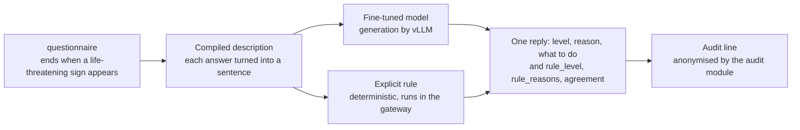

<h1 align="center">Emergency triage assistant</h1>

<p align="center">A small language model fine-tuned to triage written emergency cases, served beside a keyword rule</p>

<p align="center">
  
  
  
  
</p>

<div align="justify">

**Project status** — version 2.0.0, finished. The language model was fine-tuned for emergency
triage, aligned with DPO (direct preference optimisation) and evaluated on one RTX 4060 Ti in
October 2026, with three training seeds. The results are committed under `reports/`. A comment
above each results table, figure and paragraph, or the paragraph's own text, names the file it was
read from.

- **Model and dataset**: published on the Hugging Face Hub as
  [`qwen3-1.7b-clinical-triage`](https://huggingface.co/BenoitJT-GIRARD/qwen3-1.7b-clinical-triage)
  and
  [`clinical-triage-bilingual`](https://huggingface.co/datasets/BenoitJT-GIRARD/clinical-triage-bilingual).
  Their cards are rendered from this repository and published under the same version tag.
- **Service**: deployed on Modal and kept stopped, which costs nothing. Only the owner of this
  repository can start it, for a demonstration
  ([how it is started](infra/README.md#4-cloud-deployment-on-modal)).
- **Evidence**: `reports/run-evidence.json`, written by `scripts/smoke.py`. The script redraws
  every published figure from the committed results, and it writes the evidence file only when
  each figure comes out identical to the committed one.
- **Workflows**: started by hand only.

**This is not a medical device, and its outputs are not clinical advice.** It is a
demonstration built to study how a small language model can be fine-tuned and aligned for a
structured task. No patient should be directed anywhere on the basis of its output.

## The problem

A triage nurse reads a short narrative and decides within a couple of minutes whether a patient
is seen now, within a few hours, or later. An error in one direction costs a place in the
waiting room. An error in the other direction can harm a patient, and this repository measures
that second error: **undertriage**, an urgent patient placed lower in the queue than they should
be.

<!-- source: reports/evaluation_results.json -->
The first point of comparison is a keyword rule, of the kind a department can write in an
afternoon. On the sixty hand-written cases of this evaluation it misses more than half of the
urgent ones, because it matches words: a chest pain described as "gêne dans la poitrine"
(discomfort in the chest) contains none of its keywords. The question is whether a language model
small enough to serve on one GPU, fine-tuned on triage narratives and then aligned on
preferences, does better than that rule. A harder comparison sets it against an ordinary
classifier trained on the same examples.

Most of the work went into the ground truth. None of the public medical corpora the project read
is labelled with triage levels, so the project built its own labelled data: a clinical catalogue
written for the project, a generator that draws vignettes from it, and four public corpora read in
full, three of which yielded cases that describe a patient. [`data/README.md`](data/README.md)
and [`docs/data-source.md`](docs/data-source.md) describe the construction and what each source
yielded.

## What it does

The service has four routes, and the project centres on `/triage`.

| Route | What it returns |
|---|---|
| `POST /questionnaire/next` | the next question, from a list that depends on the complaint; collection ends as soon as a life-threatening sign appears |
| `POST /triage` | the triage level, a justification, a course of action, **and the level the explicit rule assigns** |
| `GET /health` | whether the gateway process is alive; it calls nothing else and needs no key |
| `GET /ready` | whether the inference engine answers; it requires the key, because on a managed host the call can start a GPU |

<!-- source: docs/images/MANIFEST.json -->


Every triage reply carries `rule_level`, `rule_reasons` and `agreement` beside the model's own
answer. The rule is deterministic and cannot invent a level, so when the two disagree the nurse
sees that a second method would have placed the patient elsewhere.



### How it is built

The base model is `Qwen3-1.7B-Base`, fine-tuned with LoRA (low-rank adapters) on the project's
bilingual set. **Transformers** loads the model and **PEFT** holds the adapter. **TRL** runs the
supervised pass, then the DPO pass over preference pairs in which the rejected answer carries one
deliberate defect. **Unsloth** provides training kernels that are faster and lighter on a single
consumer GPU, and **PyTorch** runs underneath. Each training run logs to a local **MLflow**
store, which keeps the four LoRA settings comparable after the runs. The ordinary baseline is a
**scikit-learn** linear classifier over n-grams, trained on the same examples.

Serving uses two processes. A **FastAPI** gateway, run by **Uvicorn**, validates the request,
runs the questionnaire, applies the explicit rule, anonymises the texts and writes the audit log.
**vLLM** generates the answer behind its OpenAI-compatible API. Request and reply shapes are
**Pydantic** models, and the contract page above is generated from them. The gateway's **Docker**
image contains no weights and no torch, so a new model version is deployed without rebuilding
it. **Modal** runs the same two processes in the cloud. Its GPU engine shuts down after fifteen
idle minutes, and the deployment stays stopped between demonstrations.

**uv** pins the environment to its lock file. In the CI workflow, Ruff checks the style and
Bandit looks for security issues. **pytest** runs three tiers of tests, the last of which starts
the gateway in its own process and calls it over HTTP. The suite imports pyarrow, the Arrow and
Parquet library that `datasets` uses, before torch, because on Windows the opposite order crashes
the process.

## The result

<!-- source: reports/evaluation_results.json -->
The evaluation uses sixty cases written by hand, forty of them urgent. None of them was seen
during training, and the rule the model is compared with played no part in their labels. The
fine-tuned models in the table are those of seed 42, the seed chosen in advance for publication.

<!-- source: reports/evaluation_results.json -->
| system | accuracy | undertriage | overtriage | format compliance |
|---|---|---|---|---|
| majority class | 0.333 | 1.000 | 0.000 | n/a |
| always critical | 0.333 | 0.000 | 0.667 | n/a |
| explicit rule | 0.617 | 0.550 | 0.017 | n/a |
| linear classifier | 0.667 | 0.200 | 0.200 | n/a |
| `Qwen3-1.7B-Base` | 0.167 | 0.525 | 0.283 | 0.467 |
| SFT + LoRA | 0.700 | 0.300 | 0.100 | 1.000 |
| SFT + DPO, merged | 0.717 | 0.275 | 0.100 | 1.000 |
> n = 60 cases, of which n = 40 are urgent. Undertriage is computed on the forty urgent cases
> and the other columns on all sixty. [`metrics.yaml`](metrics.yaml) defines each column and the
> estimator of its interval.

> **How to read it.** Each row is one system, and every system answers the same sixty cases.
> `accuracy` is the share of cases placed at the level written for them. `undertriage` is the
> share of urgent cases placed at a lower level, the error that can harm a patient, which is why
> it is computed on the forty urgent cases only. `overtriage` is the share of cases placed above
> their level, which costs a place in the queue. `format compliance` is the share of answers that
> software can parse into a level. The four baselines output a level directly, so the column does
> not apply to them (n/a).

<!-- source: reports/figures/MANIFEST.json -->


> **How to read it.** The figure has three panels, one per measure, and one bar per system. The
> middle panel shows undertriage, the share of urgent patients placed too low, where a shorter
> bar is better. The right-hand panel shows overtriage, which costs a place in the queue. Accuracy
> and undertriage carry a 95% interval, and overtriage carries none because it is not the safety
> measure. Overlapping intervals do not show that two systems perform alike. The paired tests
> below compare systems case by case.

<!-- source: reports/evaluation_results.json -->
On the n = 40 urgent cases, the shipped model misses **11** and the rule it would replace misses
**22**, twice as many. A paired test on the same cases, the appropriate test for two systems that
saw the same patients, gives **p = 0.035**. This comparison was set as the primary analysis
before the model was evaluated. The release gate is less strict, since `scripts/check_release.py`
only blocks a version whose urgent misses exceed the rule's or that gives an answer outside the
format. The deployment workflow runs it before tagging a model version on the Hub.

<!-- source: reports/evaluation_results.json -->
The comparison with the ordinary classifier comes out differently, and the project reports it
as a finding. On the same n = 40 urgent cases the model misses **11** and the classifier **8**,
and the paired test gives **p = 0.508**. Fine-tuning adds a justification and a course of action
that a nurse can read. The data show no sign that it improves the triage decision over a linear
SVM trained on n-grams.

### Combining the model's level with the rule's

<!-- source: reports/evaluation_results.json -->
Each triage reply carries both the model's level and the rule's. When the more urgent of the two is
kept for every case, the misses on the same n = 40 urgent cases fall from **11** to **5**. Six
more urgent patients are caught and none is lost, with **p = 0.031**. Overtriage stays at
**0.100**, since the single case the rule places too high is one the model also places too high.
This reading was also fixed before the results, and it requires no new model, since the
service already returns both levels. The five urgent cases still missed are missed by both the
model and the rule.

### Accuracy on the internal split and on the clinical set

<!-- source: reports/figures/MANIFEST.json -->


> **How to read it.** The left panel shows two accuracies for each model. One is measured on the
> internal split, whose cases resemble the training material, and the other on the hand-written
> clinical set, written apart from the training data. The right panel shows the difference
> between the two, with its interval. A large positive difference points to a model reproducing
> what it learnt. When the interval of the difference contains zero, this sample detects no loss.

<!-- source: reports/evaluation_results.json -->
On a random sample of n = 120 cases from the internal test split, the model scores **0.950**.
That figure mostly measures restatement. Most cases in the split were generated from catalogue
presentations that the training set also contains under other wordings, and the rest are corpus
cases labelled by the same rule as the corpus cases used in training. The clinical set, n = 60,
measures transfer, and the model scores **0.717** on it. An evaluation on the internal split
alone would therefore have overstated the model's accuracy by the gap between **0.950** and
**0.717**.

### What the alignment changed

<!-- source: reports/evaluation_results.json -->
On n = 100 preference pairs built from the hand-written cases, the aligned model favours the
correct answer over the defective one in **0.84** of the pairs. The preference it learnt on
generated narratives therefore carries over to cases written by hand. On the n = 777 pairs of an
external medical preference set the share is **0.3655**, below chance, and it is **0.500** on the
n = 180 of those pairs whose two answers have similar lengths. The alignment learnt the defects
it was shown and no measurable preference about medicine in general. Its score below chance is
consistent with a length effect, and on the pairs of similar length it is at chance. On the
clinical set, the aligned model misses one urgent case fewer than the supervised model.

### The spread across three training seeds

<!-- source: reports/seed_study.json -->
The method was trained three times, with seeds 42, 43 and 44, and seed 42 was chosen for
publication before any of the three was evaluated. Across the three runs, accuracy on the
clinical set (n = 60 cases) ranges from **0.700** to **0.783**, and the number of urgent cases
missed, out of n = 40, from **9** to **13**. The seed alone therefore shifts the result by up to
five cases in sixty. Seed 42 lies between the other two on both measures, and even the weakest
seed, at 13 misses, stays well below the rule's 22. Over the 120 urgent decisions of the three
seeds, the alignment step catches one patient the supervised model missed and loses none.

### Comparison with the previous version

<!-- source: reports/before_after.json -->
Version 1.0.0 of this repository served an earlier model. Evaluated with the same code on the
same n = 60 cases, it also scores **0.717**. Of the n = 40 urgent cases, the old model misses
**10** and the new one **11**. The old model alone catches two of those patients and the new
model alone catches one, with **p = 1.0**, so the retraining did not change the triage decision
measurably. Version 2.0.0 changed the work behind the decision: the dataset was corrected, the
model was trained on the prompt the service sends, and the analyses were fixed before the results
and repeated on three seeds.

### Training choices and what was set aside

<!-- source: reports/training/module_comparison.json -->
Training the output head together with the attention and feed-forward projections made the model
end its answers. On the n = 60 validation cases of that study, the share of answers that stop by
themselves rose from **0.0** to **1.0**, and the median answer length fell from the cap of
**220** tokens to **96**, while accuracy barely changed.

<!-- source: reports/training/engine_comparison.json -->
Unsloth's kernels made training faster and lighter on one GPU. Over the same n = 30 steps,
Unsloth took **3.69** seconds per step and peaked at **7.22** gigabytes of memory, against
**6.93** seconds and **10.13** gigabytes with plain Transformers.

<!-- source: reports/evaluation_results.json -->
Once the model was trained, the largest further reduction in missed urgent cases required no
more training. Keeping the more urgent of the two levels takes the misses from 11 to 5, as shown
above, while the alignment step took them from 12 to 11. Three options were set aside, each for a
stated reason. UltraMedical-Preference was not used as training data, because outside its pairs
of comparable length it prefers the longer answer in 470 of 597 pairs. Three of the four LoRA
settings were dropped, one of them tied with the kept setting on the validation cases and behind
it on validation loss. Harder preference pairs were not built, because only a preference set
independent of their construction could evaluate them fairly. The retraining itself moved
nothing measurable in the triage decision compared with version 1.0.0.

## Why these numbers can be believed

The evaluation set was written by hand, case by case, with the clinical reason for each label
recorded beside it. The triage rule played no part in those labels, so the comparison with the
rule is meaningful. On the corpus part of the training data, the rule recovers its own labels by
construction, and a comparison there would only measure the filter that selected the cases.

The analyses were fixed before the results. The shipped seed, the primary comparison, the
secondary comparisons and the conditions a version must meet to be published were committed
before the first model of this version was evaluated, and each of them is reported whatever its
outcome. [`docs/protocol.md`](docs/protocol.md#what-was-fixed-before-the-results) lists them.

Accuracy and undertriage carry an interval: Wilson for accuracy on sixty cases, and the exact
Clopper-Pearson interval for undertriage, whose samples are the smallest. Overtriage is not the
safety measure and carries none. Each comparison between two systems on the clinical set is a
paired test on the same cases. An overlap between two intervals is no evidence that the systems
are alike, and on paired data the overlap criterion is systematically too conservative.

The weights that were evaluated are the weights that were published. The evaluation records the
SHA-256 digest of each weight file it reads. The publication script refuses weights whose
digests differ from the recorded ones, and its `--what verify` mode checks the copy on the Hub
against them.

`scripts/build_figures.py` draws the figures from the committed result files, and
[`reports/figures/MANIFEST.json`](reports/figures/MANIFEST.json) records the sample size, the
estimator and the image digest of each one. `scripts/build_hub_cards.py` renders the Hub cards
from the same files, through two templates,
[`model-card.in.md`](infra/hub/model-card.in.md) and
[`dataset-card.in.md`](infra/hub/dataset-card.in.md). The CI workflow includes a step that fails
when a committed card differs from a fresh rendering.

### Defects found before the first release

A final review of the method before version 1.0.0 found five defects, and correcting them changed
no published figure. Four of them concerned the way a measurement was recorded:

- a missing count was written as `0`, so a summary rebuilt from a fresh clone could state that
  "0 distinct presentations" had all been seen in training. The build now computes the count and
  writes it to `data/processed/metadata.json`, which is versioned, and it is 70 presentations in
  this version;
- the number of preference answers truncated by the context window was typed by hand, while the
  function that counts it only logged the value. The evaluation now writes it to
  `reports/evaluation_results.json`, where it is 178 answers in this version;
- the endpoint benchmark published `"tokens_per_s": 0.0` for a gateway that reports no token
  count. The token throughput is now written only when the measurements include a token count;
- the overall accuracy computed its Wilson interval directly, bypassing the function that picks
  the estimator from the sample size. It now calls `interval_for_proportion`, which changes
  nothing on 60 or 120 cases and gives no interval to a subgroup of three, as the rule requires.

The fifth defect was the most serious. Four tests of the experiment-tracking module failed in the
environment that continuous integration installs, because `describe_environment()` imported
torch without a guard. Those four tests check that a tracking failure never stops a training run.
A missing library is now reported as `unavailable`, and the whole suite passes without the
training dependency group.

## Running it

Requirements: [uv](https://docs.astral.sh/uv/) and Python 3.12. Training needs an NVIDIA GPU,
which Unsloth requires at import, and serving the model needs Docker.

```bash
uv sync
uv run clinical-triage          # what is configured, and what is present
uv run pytest                   # the three tiers
```

The pipeline runs in the order below. Building the dataset needs access to the Hub. The tuning,
the two training runs and the evaluation need a GPU, and the two merges run on the CPU:

```bash
uv run python scripts/build_dataset.py
uv run python scripts/tune_hyperparameters.py                    # the four LoRA settings
uv run python scripts/tune_hyperparameters.py --study modules    # effect of the output head
uv run python scripts/tune_hyperparameters.py --study engines    # Unsloth against Transformers
uv run python scripts/train_sft.py
uv run python scripts/merge_adapter.py --adapter sft
uv run python scripts/train_dpo.py
uv run python scripts/merge_adapter.py --adapter dpo
uv run python scripts/run_evaluation.py
uv run python scripts/check_release.py
uv run python scripts/build_figures.py
```

Passing `--seed 43` to the four training steps and to the evaluation trains and evaluates another
seed, stored apart from the shipped one. `scripts/aggregate_runs.py` then puts the seeds side by
side.

To run the service locally with the engine beside it:

```bash
export TRIAGE_API_KEY="a-key-of-your-choosing"
docker compose -f infra/docker-compose.yml up --build
```

On a Windows workstation the pinned engine stops before it loads the weights.
[`infra/README.md`](infra/README.md#2-the-full-container-stack) gives the override that starts an
earlier engine version. [`.env.example`](.env.example) lists every variable the gateway reads.
[`docs/operations.md`](docs/operations.md) and [`infra/README.md`](infra/README.md) describe the
deployment, on a workstation and on Modal, and what it costs.

<!-- source: docs/images/MANIFEST.json -->


## Structure

```
.
├── src/clinical_triage/   # the package: config, prompts, data, training, evaluation, serving
├── scripts/               # the pipeline, one entry point per step
├── tests/                 # unit, integration, system
├── notebooks/             # the five project notebooks, one per stage
├── docs/                  # documentation pages and screenshots
├── reports/               # the results, the figures and their manifest
├── data/                  # evaluation set, dataset metadata and the data card
├── infra/                 # image, compose, deployment, Hub cards
└── var/                   # untracked run outputs: weights, logs, experiment store
```

[`docs/architecture.md`](docs/architecture.md) explains each design decision and the
alternatives that were rejected. [`CHANGELOG.md`](CHANGELOG.md) lists what version 2.0.0 changed
from 1.0.0: a corrected dataset, a model retrained on three seeds, and a release gate.

## What this does not prove

The clinical catalogue behind the training data was written for this project and **has not been
validated by an emergency physician**. The model must not be used on patients.

<!-- source: reports/evaluation_results.json -->
Sixty cases make a small evaluation, and the 95% interval on the shipped model's accuracy runs
from 0.59 to 0.81. With forty urgent cases, the exact upper bound on undertriage stays at nearly
nine missed patients in a hundred even for a model with no miss at all, and bringing that bound
under five in a hundred requires seventy-two urgent cases without a miss. The comparison with
the ordinary classifier is far from significant in either direction, so the data support "the
model is not shown to be better" and do not support "the model is worse". Three seeds measure
how much training alone moves the results, and cases written by another author would be needed
to show how the model behaves outside this set.

The alignment shows no transfer beyond the defects it was trained on. The service's latency
([`docs/operations.md`](docs/operations.md#what-one-decision-costs)) was measured on the
deployment itself, in three runs on a single evening, from one workstation far from the service,
so it does not amount to a capacity plan. The three triage levels simplify the five levels of
the French emergency triage scale. The model reads French and English and always answers in
French, and the questionnaire exists in French only.

## Licence and data

The code is under the MIT licence (see [LICENSE](LICENSE)). The published model weights are
under Apache-2.0, the licence of the base model they derive from, and the published dataset is
under CC BY 4.0.

The training set draws on three public medical corpora, each used under its own licence and
credited in the data card. The clinical vignettes and the evaluation cases were written for this
project, and no real patient data is used. The [data card](data/README.md#personal-data) reports
the masking applied to the corpus texts and the residue that a separate check still finds after
it.

</div>
