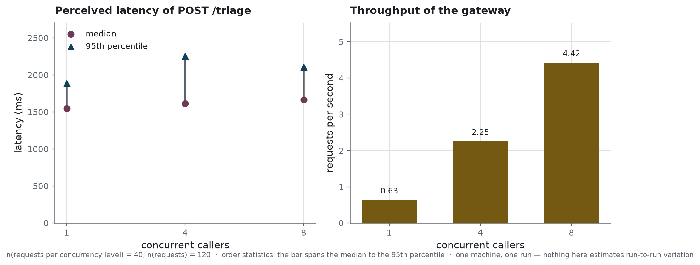

# Operations

What it takes to run the service, what it costs, how it fails, and what it leaves behind. The
deployment commands themselves are in [`../infra/README.md`](../infra/README.md); this page is
about running the thing once it is up.

The reader this page expects is whoever is on call for it.

## The two processes

The gateway answers HTTP and holds no model. The engine holds the model and answers one route.
They are separate containers, and that separation is what most of this page is about: almost
every failure is one of them being up while the other is not.

| process | what it needs | what happens without it |
|---|---|---|
| gateway | a service key, a writable audit log | refuses to start, and says which of the two is missing |
| engine | a GPU, the weights at a pinned revision | the gateway starts, `/ready` answers 503, and every triage is refused with 503 |

The gateway **refuses to start** without `TRIAGE_API_KEY`, unless open mode is asked for
explicitly. A check that disappears when its setting does is not a check at all, and refusing to
start is the only way to show that at deployment, before the first request.

It also opens the audit log at startup, empty, and refuses to serve if it cannot. Tracing every
interaction is one of this service's obligations, and answering without being able to write down
the answer breaks it. The case is not theoretical: a volume mounted from the host arrives owned
by root, and the service does not run as root.

## Two probes, and what each one says

`GET /health` is the gateway's liveness. It answers `alive` as soon as the process serves,
touches nothing else and needs no key: an anonymous caller can probe it as often as it likes, and
never reaches the engine through it.

`GET /ready` questions the engine. It answers `ok` when the engine replies, and `degraded` with a
503 otherwise; in the degraded case it says that the engine is not answering — never where the
engine is. The technical cause, which carries the engine's address, goes to the log. It asks for
the service key, because on a managed host a request that reaches the engine can wake a GPU, and
the engine's address is part of what protects it.

A consequence worth knowing when a container restarts: the gateway is alive long before it is
ready, because the engine takes minutes to load three gigabytes of weights. A deployment waits on
`/ready`, never on `/health`.

## What one decision costs

<!-- source: reports/benchmark_endpoint.json -->


> **How to read it.** Both panels share a horizontal axis counting callers hitting the service
> at once. The upper one is what a caller waits, the bar running from the median to the
> ninety-fifth percentile, so its length is how much worse an unlucky call is than a typical
> one. The lower one is how many requests the gateway completes per second. A wait that climbs
> while throughput flattens means the queue, and not the model, is the limit.

<!-- source: reports/benchmark_endpoint.json -->
One triage takes **1,473.5** milliseconds at the median with a single caller, n = 40 requests,
and **1,682.6** at the 95th percentile. The gateway's own share of that is **28.3** milliseconds:
validation, the questionnaire, the explicit rule, the anonymisation and the audit line together
cost under two hundredths of the answer. Everything else is generation.

<!-- source: reports/benchmark_endpoint.json -->
With eight concurrent callers, n = 40 requests each, the median moves to **1,592.0** milliseconds
and the throughput to **4.71** requests per second. The engine absorbs concurrency well; what
degrades is the tail, at **2,244.9** milliseconds for the 95th percentile.

These are order statistics on one machine, one run, against one engine version. They are not a
capacity plan, and the repository does not claim one.

## The quota

Every triage takes a GPU for a second and a half. An endpoint without a quota is an endpoint
anyone can saturate, so the gateway counts requests per caller over a sliding minute and answers
429 above the limit — announcing the limit in the message, so that an integrator does not have to
discover it by trial and error.

Two details that were defects first. The key counts as an identity **only where it was checked
against something**: open mode checks nothing, so a caller who changed the header at every
request used to be handed a fresh bucket each time. There, the address is the identity instead.
And callers that have gone quiet for a minute are dropped from the table, without which it grows
by one entry per address seen since startup — protection that ends up costing more than what it
protects.

The default is sixty a minute, which fits a reception desk. A load bench holds a single key and
passes that from its first concurrency level, so the compose file lets the value be raised for
the duration of a measurement without changing the service value.

## The audit log

One JSON line per interaction, appended, readable without a tool. It carries the request id, the
timestamp, the anonymised description, the level, the rule's level and reasons, the anonymised
answer, whether the description was bounded, the latency, the model that actually answered, the
engine, the retention period in days, and the digest of the line before it.

Five things about it are not obvious.

**Both texts are masked, not just the incoming one.** The model's justification repeats what the
nurse wrote, so a name removed from the description would walk back in through the answer. Each
text goes through the engine of its own language, once: running the English pass over a French
narrative used to mask clinical words as if they were names.

**The model version is read from what is loaded**, and passed at call time rather than taken from
a setting. A setting can name one model while another answers, and a trace that can say the wrong
thing is not a trace.

**The retention is applied, not only announced.** The log is one file per day, and the files
older than the retention period are deleted at startup and on the first write of each day. The
period is also written into every line, so the obligation travels with the data.

**A modification shows.** Each line carries the SHA-256 digest of the line before it, across
files. Editing, inserting or deleting a line breaks the chain from that point on, and one command
names where:

```bash
uv run python scripts/verify_audit_log.py var/logs/audit
```

It detects, it does not prevent: a file the host can delete is still a file. Detection is what an
audit needs.

**One writer.** Appending to a file is atomic for one process, so the deployment runs a single
gateway container. That is a limit of scale, stated rather than worked around.

In the container the log is a named volume. A host folder is mounted as root, and the service
runs unprivileged: every request then failed on the write, after having produced its decision.
`docker compose cp api:/app/var/logs/audit .` takes a copy out; on Modal, the log lives on the
`clinical-triage-audit` volume, and `modal volume get clinical-triage-audit / ./audit` does the
same.

## When something is wrong

| symptom | what it means | what to do |
|---|---|---|
| the gateway exits at startup | no `TRIAGE_API_KEY`, or the audit log is not writable | the message names which; both are configuration, not code |
| `/ready` answers 503 | the engine is not answering | look at the engine's log; the gateway is fine and will recover on its own |
| every triage answers 503 | the same thing, seen from the caller's side | the caller is told to retry, and is told nothing about the engine |
| 422 on a long description | over 800 characters, the bound of the training narratives | the reply says so; shorten the narrative to the clinical facts |
| 422, "does not fit the model window" | the engine refused a narrative its window cannot hold | the text, not the service, has to change |
| 401 on every call | the key presented does not match | the contract page names the header; the service compares in constant time |
| 429 under a bench | the quota, working | raise `TRIAGE_RATE_LIMIT` for the measurement, not for the service |
| `verify_audit_log.py` names a line | the log was edited, or a line went missing, from there on | keep the copy as it is; the chain says where, not who |

<!-- source: data/processed/metadata.json -->
The two 422 deserve their sentence. Cutting a patient's story without saying so is the one thing a
system of this kind must never do, so the gateway refuses a description longer than 800
characters — the same bound the build places on every training narrative — rather than serving a
text unlike anything the model learnt on. The bound is in characters because the gateway carries
no tokenizer, which is the point of a thin gateway. When the engine still refuses a text, the
caller is told that the text is the cause, not that the engine is down: retrying would change
nothing.

## What is deployed, and what is not

The on-demand deployment raises the same pair: one container with a card, running vLLM over the
merged weights, and the gateway of the Docker image, unchanged. Nothing is rewritten, only rewired.
The engine shuts itself down after fifteen minutes of silence and wakes on the next request that
gets through to it.

Two doors keep a stranger from getting through. The engine sits behind the host's proxy
authentication: a request without the workspace's proxy token is refused before any container
starts, so finding the engine's address buys nothing — no generation on someone else's card,
untraced, unmasked, uncounted and billed to them. And the gateway's only open route is its
liveness probe, which touches nothing else.

**The service is deployed, and stopped.** Stopped, it costs nothing and answers nothing; only the
owner of the repository starts it, for a demonstration, and stops it afterwards. How, and who
holds the keys, is in [`../infra/README.md`](../infra/README.md#4-cloud-deployment-on-modal).
