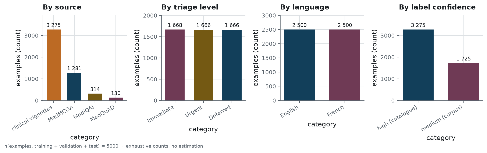
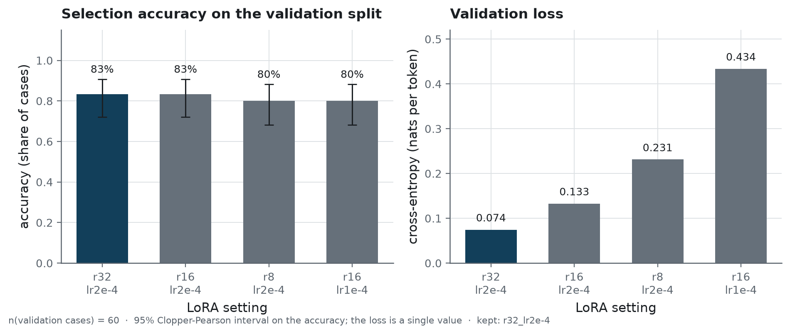
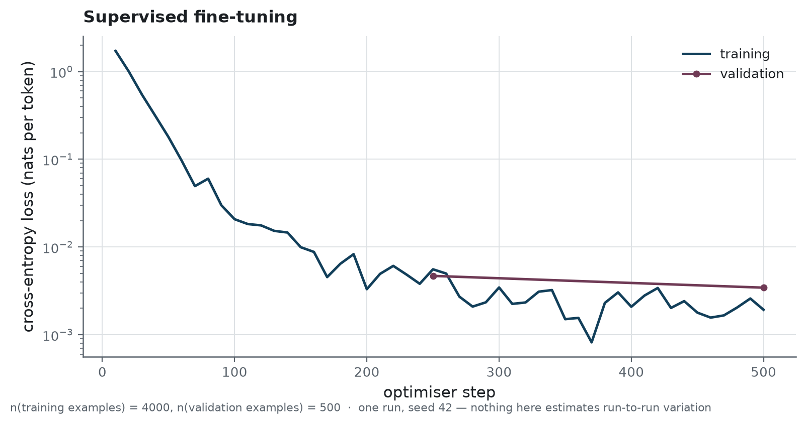
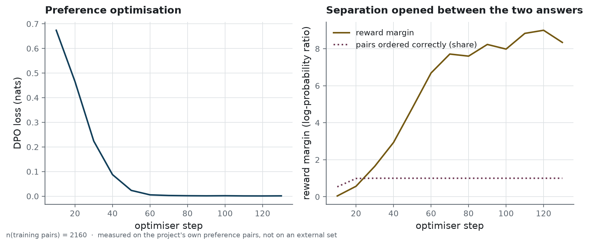
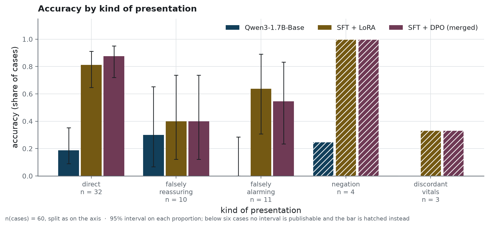
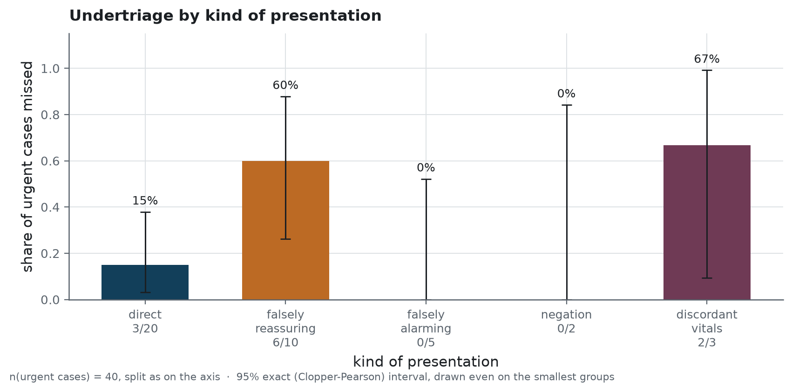
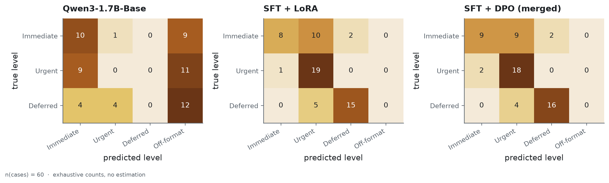

# Protocol

How the published numbers were produced, and what each of them can and cannot support. The
figures below are drawn by `scripts/build_figures.py` from the result files under `reports/`;
each carries its sample size and its estimator in the image itself, and
[`../reports/figures/MANIFEST.json`](../reports/figures/MANIFEST.json) records what was drawn
from what.

The reader this page expects is someone who wants to check the claims, not take them, and
who will look for the place where the protocol could have flattered itself.

## What is measured, on which population

Two evaluation sets judge the triage decision, deliberately, because they answer different
questions.

The **clinical set** is sixty cases written by hand, one at a time, each with the clinical reason
for its label recorded beside it. Forty of them are urgent. None was seen during training, and the
explicit rule never touched their labels — without which comparing the model to that rule would
prove nothing. Nearly half are written to mislead: a presentation that sounds reassuring and is not,
one that sounds alarming and is not, a negation, a vital sign that contradicts the narrative.

The **internal test split** is a hundred and twenty cases held out of the training data, drawn by
the same generator from the same catalogue. Every presentation in it was seen during training
under another wording. It measures restatement, and it is published so that the distance between
the two sets can be read.

Three more sets probe what a triage decision cannot show:

- the test split of **UltraMedical-Preference**, 777 pairs of medical answers whose better one
  GPT-4 picked and biomedical experts reviewed, never trained on. It says whether the alignment
  learnt anything about medicine at large;
- a **task-format preference set** of 100 pairs, built on the sixty hand-written narratives:
  each pair holds the reference answer and the same case answered with one defect. It says
  whether what the alignment learnt on generated narratives holds on written ones;
- 41 **degraded inputs** in nine families, from an empty description to a prompt injection. They
  say whether the service keeps its contract on what is not a clinical narrative.

<!-- source: data/processed/metadata.json -->

> **How to read it.** Four counts of the same five thousand training examples, each cut a
> different way. Bar height is a number of examples. The panels answer whether any one source,
> level, language or confidence grade dominates the set, since a model trained on a lopsided
> corpus learns the lopsidedness first. Read them together: a balance holding in one panel and
> breaking in another is still an imbalance.

The training corpus itself is balanced by construction across the three levels and the two
languages; where its cases come from, and what the public corpora really yielded, is in
[`data-source.md`](data-source.md).

## What was chosen, and on what

### The LoRA setting

Four settings were trained on the same twelve hundred examples, for the same seventy-five steps,
and judged on the sixty cases of the validation split. The rule was fixed before the runs: the
highest accuracy, then the lowest validation loss.

<!-- source: reports/training/hyperparameter_comparison.json -->

> **How to read it.** Four LoRA (low-rank adaptation) settings, each fine-tuning only a small
> added matrix and leaving the base weights alone. The left panel is triage accuracy on the
> validation split, higher being better, each bar with a 95 % interval. The right panel is
> validation loss in nats per token, where lower is better. Sixty validation cases give wide
> intervals, so a setting wins only when the two panels agree.

<!-- source: reports/training/hyperparameter_comparison.json -->
Two settings tie at **0.833** on the n = 60 validation cases, `r32_lr2e-4` and `r16_lr2e-4`, and
the loss separates them: **0.0745** against **0.1328**. `r32_lr2e-4` is kept. The two others
reach **0.8**.

Read with its interval, that ranking is not established: two answers in sixty separate 0.833
from 0.8, far less than the width of either interval. The loss ordering agrees with it, and the
loss is measured on more than sixty numbers. And 0.833 is the winner's score on the very cases
that chose it, so it is optimistic by construction: a selection score, not a result. The clinical
set, which chose nothing, is the one that reports.

### The end-of-sequence token

The supervised run trains the output head alongside the LoRA projections, which is not the usual
recipe. It is there because of a property of this base model.

Its twenty-five ChatML control tokens share a single untrained vector: `im_start` and `im_end`
have a cosine similarity of 1.000 to the third decimal. The output head is tied to the embedding
matrix, and LoRA freezes both. Nothing in the adapters can therefore teach the model to close its
turn, and every answer runs to the generation cap.

<!-- source: reports/training/module_comparison.json -->
A short study measures it: three sets of trained modules at the same rank, on the same twelve
hundred examples and seventy-five steps, judged on the n = 60 validation cases. With the projections
alone, or with the embeddings added, the share of answers that stop on their own is **0.0**, and the
median answer runs to the cap of **220** tokens. With the output head added, that share is **1.0**
and the median falls to **96** tokens. Accuracy barely moves, **0.833** against **0.817**: the head
buys an answer that ends, not a better decision.

<!-- source: reports/training/sft.json -->

> **How to read it.** The horizontal axis is optimiser steps, and both curves are cross-entropy
> in nats per token, a measure of how surprised the model is by the correct next token. Lower
> means less surprised. The training curve falling while the validation curve stops falling is
> the signature of memorisation beginning, which is what decides where the run is stopped.

<!-- source: reports/training/sft.json -->
The run trains **346,030,080** parameters of 2,377,769,984, that is **14.553%**, which is what
the output head adds to the adapters. Over n = 4,000 training examples and two epochs it takes
**1,821.4** seconds on one RTX 4060 Ti, never exceeds **7.43** gigabytes of GPU memory, and ends
at a validation loss of **0.0034**.

### The training engine

<!-- source: reports/training/engine_comparison.json -->
Unsloth and plain Transformers ran the same n = 30 steps, on the same examples and the same modules.
Unsloth takes **3.69** seconds a step and peaks at **7.22** gigabytes; Transformers takes **6.93**
seconds and **10.13** gigabytes. The losses end close, **0.9727** against **0.9448**. The engine
changes what a run costs, not what it learns, and on one card the cost decides.

### The preference run

<!-- source: reports/training/dpo.json -->

> **How to read it.** Two views of the same alignment run. DPO (direct preference optimisation)
> shows the model a preferred answer and a rejected one and pushes them apart. The left panel is
> its loss, falling as the pair separates. The right panel is the reward margin, the log of how
> much likelier the preferred answer has become, and it should climb. A flat margin means the
> loss fell without the preference being learnt.

<!-- source: reports/training/dpo.json -->
On its own validation pairs the alignment is complete: n = 240 pairs, **1.0** of them ordered
correctly, with a reward margin of **8.66**. The loss is near zero within sixty steps: the pairs
are easy to tell apart, which is what one deliberate defect per pair makes them. That number
measures the alignment against the defects it was trained on, and nothing else. What it is worth
elsewhere is further down this page.

## How two systems are compared

Never by the overlap of two confidence intervals. Two systems evaluated on the same cases are
paired data, and on paired data the information lives entirely in the cases where they disagree:
comparing marginal intervals throws that away, and is systematically too cautious. Two intervals
that all but coincide can still sit either side of a real difference.

Every comparison in this repository is therefore an **exact McNemar test** on the same cases, and
what it reports is the count each way — how many cases the model saves that the baseline loses,
and the reverse. The counts are published beside the p-value, because they are what the p-value
is computed from and because they are readable on their own.

The same test, restricted to the urgent cases and to undertriage alone, is what separates the
model from the rule. Accuracy dilutes: a system can be wrong often without danger and rarely with
danger, and a triage tool is judged on the second.

## What was fixed before the results

These choices were written down and committed before any model of this version was evaluated,
and the results are published whatever they show.

- **The shipped model is fixed in advance**: the one trained on seed 42, whatever its score. Seeds
  43 and 44 measure the spread of the method and nothing else: keeping the best of three on the
  clinical set would turn that set into a selection set.
- **The primary analysis** is undertriage on the forty urgent cases, the shipped model against
  the explicit rule, by an exact McNemar test.
- **The secondary analyses**: the shipped model against the linear classifier; the supervised model
  against the aligned one, for each seed; the *more urgent of the two opinions* (for each case, the
  more urgent of the model's level and the rule's) against the model alone, on undertriage and on
  overtriage; the model of version 1.0.0, as this repository served it, against this version's, on
  the same cases; and the spread of the three seeds, as the range and the standard deviation of
  accuracy and of undertriage.
- **The release gate**: every answer of the clinical set in the expected format, and at most as many
  urgent cases missed as the explicit rule misses. A version that fails it is neither published nor
  served. `scripts/check_release.py` decides, and the deployment workflow runs it.

## What those analyses found

### The model against the rule

<!-- source: reports/evaluation_results.json -->
On the n = 40 urgent cases, the shipped model misses **11** and the explicit rule **22**. The
model catches **17** urgent patients the rule sends down the queue, and misses **6** the rule
catches. The exact McNemar test on those counts gives **p = 0.0347**: the model misses fewer
urgent patients than the rule, and a gap that size is unlikely to be chance.

### The model against the classifier

<!-- source: reports/evaluation_results.json -->
On the same n = 40 urgent cases, against the linear classifier, the model misses **11** and the
classifier **8**: **3** urgent patients caught by the model alone, **6** by the classifier alone,
**p = 0.5078**. Accuracy on all n = 60 cases gives the same reading, **0.7167** against **0.6667**,
**p = 0.6291**. Nothing separates them. Sixty cases support "the model does not beat n-grams here";
they do not support "the model is worse".

### The aligned model against the supervised one

<!-- source: reports/evaluation_results.json -->
On seed 42, of the n = 40 urgent cases, the aligned model misses **11** and the supervised model
**12**. One case separates them, in one direction, and the test gives **p = 1.0**.

<!-- source: reports/seed_study.json -->
On seeds 43 and 44, the two models miss exactly the same of the n = 40 urgent cases: **9** each on
seed 43, **13** each on seed 44. Over the three seeds, the alignment turns one urgent miss into a
catch, out of a hundred and twenty urgent decisions, and loses none. On accuracy, over the n = 60
cases, the aligned model is right on one or two more cases than the supervised one on every seed:
**0.7833** against **0.75** on seed 43, **0.7** against **0.6833** on seed 44. No seed's test comes
near significance; the largest gap, seed 43's, gives **p = 0.5**. The alignment does not move the
triage decision. What it does move is measured where it acts, in [What the alignment
bought](#what-the-alignment-bought-and-what-it-did-not).

### The more urgent of the two opinions

<!-- source: reports/evaluation_results.json -->
For each case, keep the more urgent of the two levels, the model's and the rule's. On the n = 40
urgent cases that policy misses **5**, against **11** for the model alone: **6** urgent patients
caught, none lost, **p = 0.0312**. Overtriage stays at **0.1**: raising a level can only add
overtriage, and on these sixty cases it added none, because the rule almost never overshoots.
Accuracy rises to **0.8167**.

The reply already carries both levels, so this policy needs no new model: it is a reading of what
the service returns. The five urgent patients it still misses are the ones both systems miss.

### This version against the previous one

<!-- source: reports/before_after.json -->
The model of version 1.0.0, as this repository served it, evaluated by the same code on the same
sixty cases, scores **0.7167**: the same accuracy as this version. On the n = 40 urgent cases it
misses **10** and this version **11**: **1** urgent patient caught by this version alone, **2**
by the previous one alone, **p = 1.0**. The two are compared on the clinical set only: the
internal split was rebuilt with the dataset.

The retraining did not change the triage decision by anything sixty cases can measure. What it
changed is what stands behind the decision: a corrected dataset, a system prompt that is now the
one the service sends, and an evaluation fixed in advance and repeated on three seeds.

### The spread of the three seeds

<!-- source: reports/seed_study.json -->
Over seeds 42, 43 and 44, the aligned model's accuracy on the n = 60 cases of the clinical set runs
from **0.7** to **0.7833**, with a mean of **0.7333** and a standard deviation of **0.0441**. The
urgent cases missed, out of n = 40, run from **9** to **13**, with a mean of **11** and a standard
deviation of **2.0**. Same data, same setting: training alone moves the model by up to five cases in
sixty, and by four urgent misses in forty.

<!-- source: reports/seed_study.json -->
Two systems trained once each can therefore differ by that much on the seed alone. The shipped seed
is not the best of the three: seed 43 misses **9** of the n = 40 urgent cases and scores **0.7833**,
and shipping it would have reported a better model than the method produces on average. The worst
seed still misses far fewer urgent patients than the rule, 13 against 22.

### What zero misses would still not prove

<!-- source: reports/evaluation_results.json -->
A model that missed none of the n = 40 urgent cases would still carry an exact upper bound of
**0.0881** on its undertriage: forty cases cannot tell a model that never misses from one that
misses nearly nine urgent patients in a hundred. It takes **72** urgent cases without a miss to
bring that bound under **0.05**. The clinical set can measure a large difference, like the one
against the rule. It cannot certify a small rate.

## Which intervals, and why

| quantity | estimator | why this one |
|---|---|---|
| accuracy | 95% Wilson | well behaved away from the bounds, on sixty cases |
| undertriage | 95% exact, Clopper-Pearson | the sample is forty cases, and smaller by subgroup; the exact interval does not promise coverage it does not have |
| difference between two independent sets | 95% Newcombe | the internal and clinical sets are independent, so the difference needs its own interval rather than a subtraction of two |
| overtriage | none | not the safety metric; an interval on everything teaches the reader to ignore them |

The exact interval is checked against the closed-form beta quantile in the test suite: the
package computes its bound by bisection on the cumulative binomial, without adding a
dependency, and the test verifies that the choice costs no precision.

## Where the model fails

<!-- source: reports/evaluation_results.json -->

> **How to read it.** The sixty cases split by the trap each one sets, with three bars per group for
> the base, the supervised and the aligned model. A hatched bar carries fewer than six cases, too
> few for an interval to mean anything, and the hatching is there to stop a ranking being read in.
> The groups that hold enough cases are the only ones a difference can be claimed on.

<!-- source: reports/evaluation_results.json -->

> **How to read it.** The same split, restricted to the forty urgent cases and to the shipped model,
> with shorter bars being better: each one is the share of that group's urgent patients filed below
> where they belonged. The interval is the exact one and never the approximation, since groups of
> two or three patients break the usual formula. A tall bar on a small group names a weakness worth
> probing, and never a measured rate.

<!-- source: reports/evaluation_results.json -->
On the cases that present straightforwardly, n = 32, the model reaches **0.875** accuracy and
misses **3** of the twenty urgent ones. On the falsely reassuring cases, n = 10, all of them
urgent, it reaches **0.4** and misses **6**. That is the failure mode, and it is the one that
matters: a presentation written to sound benign is exactly what a triage desk sees on a bad day.

The subgroup samples are small, three cases for discordant vitals and four for negation, and
the figures say so instead of drawing a rate on them: below six cases no interval is publishable
and the bar is hatched. What those subgroups support is "this is where to look next", not
a measurement.

<!-- source: reports/evaluation_results.json -->

> **How to read it.** One grid per model. Rows are the level a nurse assigned, columns the level
> the model returned, and each cell counts the cases falling in that pair. The diagonal is
> agreement. Everything below the diagonal is a patient sent somewhere gentler than they needed,
> everything above is caution, and the extra column on the right holds answers no information
> system could parse.

<!-- source: reports/evaluation_results.json -->
The confusion matrices carry a column the triage scale does not have: **off-format**. An answer
nothing can parse predicts nothing, and putting it in a level would attribute to that level an
error it did not make. For the shipped model the column is empty; for the base model it holds
**32** of the n = 60 answers.

<!-- source: reports/evaluation_results.json -->
Read by level, n = 20 cases each, the shape of the failure is plain: recall on the
life-threatening level is **0.45** while its precision is **0.8182**. All eleven urgent cases the
model misses are life-threatening ones filed lower, nine of them as moderate; no moderate case is
filed below its level. The model is reluctant to send a patient to the top level, and right when
it does.

<!-- source: reports/evaluation_results.json -->
The rule fails differently. Of the n = 40 urgent cases, it misses **22**; of those, it reads nothing
at all in **10**, reads only a lesser sign in **8**, and in **4** finds the life-threatening sign
and discards it because a negation stands in front of it. A rule reads words, and a description that
names no sign it knows is invisible to it.

## What the alignment bought, and what it did not

The alignment is measured where it acts: on the likelihood the model gives to two answers of the
same question, read once with the alignment and once without it. A pair counts as correctly
ordered when the alignment raised the preferred answer more than the rejected one.

<!-- source: reports/evaluation_results.json -->
On the n = 100 task-format pairs, built on the hand-written narratives, it orders **0.84**
correctly: **0.85** of the pairs with an asserted diagnosis and **0.825** of those with an
undertriage. What the alignment learnt on generated narratives holds on written ones.

<!-- source: reports/evaluation_results.json -->
On the n = 777 pairs of the external test split it orders **0.3655** correctly, below chance, and
the split itself says why. Outside the group built to compare answers of similar length, the
preferred answer is the longer one in **470** of **597** pairs. The alignment lowered **0.751** of
all the answers it read, and settled only **0.39** of the pairs in favour of the longer answer. On
the n = 180 pairs matched in length it orders **0.5**, chance exactly. It learnt nothing about
medicine at large, and its score below chance is a matter of length, not a preference for worse
answers.

On the clinical set, the aligned and the supervised model differ on one urgent case. The
alignment moved the likelihoods it was trained to move, and that barely reaches a triage
decision.

## Robustness, and what it is not

<!-- source: reports/evaluation_results.json -->
Forty-one degraded inputs in nine families go to each model: nothing to triage, a request that
is not a triage, an attempt to extract the system prompt, a change of role, an encoding trick, a
third language, a complaint drowned in another story, an over-long input, and identifying data.
An answer is compliant when it keeps the contract: a parseable level, in French, no system prompt
leaked, a clean stop, no identifying data echoed back, and, where the input announces its level,
that level kept. The shipped model is compliant on **35** of the n = 41. It resists all five
extraction attempts, and gives way on a request for code, a greeting, a poem, a description in
Spanish, a bleeding told in small talk and a vital sign placed at the end of a long input.

Forty-one cases is a probe, not a measurement: it says the service does not fall over on inputs
that are not clinical narratives. A security evaluation of prompt injection is a different
exercise, and this repository has not done it.

## What the protocol cannot rule out

Three training seeds, one card, one set of sixty cases. The seeds measure how much the training
alone moves the numbers, and the interval on each proportion covers the sampling of the sixty
cases. Nothing covers a different set of cases written by someone else.

The evaluation set was written by the same person who wrote the catalogue. They share an author,
and therefore a way of describing a patient; a case written by a nurse would not look like these.
That is the limitation most likely to flatter the numbers, and no measurement in this repository
addresses it.

Against the ordinary classifier, nothing is established either way, and the clinical set is too
small to certify a low undertriage rate whatever the model does.
